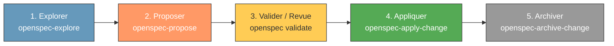

# 🤖 Instructions pour les agents IA — Super Chapelaine

> Ce fichier contient les instructions complètes pour tout agent IA travaillant
> sur le projet Super Chapelaine (club de handball La Chapelaine).

---

## Pré-requis obligatoire : OpenSpec (Spec-Driven Development)

Ce projet applique rigoureusement la méthodologie **OpenSpec** (développement piloté par les spécifications).

### Règle d'or pour tout agent IA

> ⚠️ **Obligation absolue** : Pour tout agent IA, vérifier avant chaque nouvelle session que le workflow OpenSpec est actif et respecté.
> **Toute modification en dehors de ce workflow doit être expressément demandée et justifiée par l'utilisateur**, même en mode automatique forcé.

### Étapes de vérification de la configuration OpenSpec

Avant de débuter tout travail, exécuter la commande de vérification :

```bash
make openspec-verifier
```

L'agent ou le développeur doit s'assurer des points suivants :

1. **Présence du binaire `openspec` dans le `PATH`** :
   ```bash
   openspec --version
   ```
   Si la commande n'est pas trouvée :
   - Installation via Homebrew :
     ```bash
     brew install openspec
     ```
   - Ou installation autonome (sans dépendance Node.js) :
     ```bash
     curl -fsSL https://raw.githubusercontent.com/fission-codes/openspec/main/install.sh | bash
     ```
   - Ou via npm (outil CLI global uniquement) :
     ```bash
     npm install -g openspec
     ```

2. **Vérification de la racine et de la santé du projet** :
   ```bash
   openspec doctor
   ```
   La commande doit indiquer `OpenSpec root: ok`. Le fichier de configuration `openspec/config.yaml` doit exister à la racine.

3. **Validation des spécifications et des modifications en cours** :
   ```bash
   openspec validate --all
   ```
   Toutes les spécifications du dossier `openspec/specs/` et propositions dans `openspec/changes/` doivent être conformes au schéma.

4. **Présence des compétences et workflows pour agents** :
   Vérifier que les répertoires d'instructions et compétences existent (`.agents/skills/`, `.opencode/skills/`, ou `.claude/skills/`).
   Pour synchroniser ou mettre à jour les instructions agent avec le CLI installé :
   ```bash
   openspec update
   ```

### Cycle de travail OpenSpec (Workflow standard)

Toute modification structurelle ou fonctionnelle suit le cycle standard :



1. **Explorer (`openspec-explore` ou `/opsx-explore`)** : clarifier le besoin, poser les questions nécessaires à l'utilisateur avant toute formalisation.
2. **Proposer (`openspec-propose` ou `/opsx-propose <nom>`)** : générer la proposition (`proposal.md`), les spécifications delta (`specs/<domaine>/spec.md`), la conception (`design.md`) et les tâches (`tasks.md`).
   > ⛔ **Frontière stricte** : Ne JAMAIS modifier le code applicatif pendant la phase de proposition.
3. **Appliquer (`openspec-apply-change` ou `/opsx-apply`)** : implémenter le code pas à pas une fois la proposition validée.
4. **Archiver (`openspec-archive-change` ou `/opsx-archive`)** : intégrer les spécifications au tronc commun et clore la modification.

---

## Architecture et stack technique

### Principes fondamentaux

- **JavaScript vanilla ES Modules** uniquement — pas de bundler, pas de transpileur
- **Aucun backend** — tout fonctionne côté client dans le navigateur
- **CSS natif** avec variables CSS (`--orange`, `--dark`, etc.)
- **HTML déclaratif** dans `index.html`
- **Hébergement** : GitHub Pages
- **Librairies externes** : uniquement via CDN (jamais de `node_modules`)

### Ce qu'on n'utilise PAS

- ❌ `package.json`, `npm`, `yarn`, `pnpm`
- ❌ Webpack, Vite, Rollup, esbuild
- ❌ TypeScript, Babel, PostCSS
- ❌ React, Vue, Angular, Svelte
- ❌ Serveur backend, API, base de données

---

## Structure des fichiers

```
super-chapelaine/
├── index.html              ← Point d'entrée unique (SPA)
├── Makefile                ← Harness et commandes du projet
├── AGENTS.md               ← Ce fichier (instructions agents IA)
├── README.md               ← Documentation pour humains
│
├── js/                     ← Modules JavaScript ES6+
│   ├── app.js              ← Point d'entrée JS & routage inter-modules
│   ├── attestation/        ← Module Attestation de paiement
│   │   ├── attestation-app.js
│   │   ├── calcul-tarif.js
│   │   ├── csv-licencies-parser.js
│   │   └── generateur-docx.js
│   └── com-hebdo/          ← Module Communication hebdomadaire
│       ├── com-hebdo-app.js
│       ├── competitions.js
│       ├── csv-parser.js
│       ├── data-cleaner.js
│       ├── data-extractor.js
│       ├── google-config.js
│       ├── google-sheets.js
│       ├── kifekoi-renderer.js
│       └── visuel-renderer.js
│
├── css/                    ← Feuilles de style
│   └── style.css           ← Styles principaux avec variables CSS (:root)
│
├── ressources/             ← Modèles et données
│   ├── attestation-de-paiement/  ← CSV et DOCX pour attestations
│   └── modele-attestation-de-paiement/
│
├── mail/                   ← Scripts utilitaires autonomes (mails)
├── matchs/                 ← Jeux d'essai CSV GestHand
├── docs/                   ← Documentation détaillée
│   ├── architecture.md     ← Architecture avec diagrammes Mermaid
│   ├── com-hebdo.md        ← Spécification fonctionnelle et technique Com' Hebdo
│   └── developpement.md    ← Guide de développement
│
├── openspec/               ← Spécifications et configuration OpenSpec
├── .sessions/              ← Logs des sessions IA (Markdown)
└── .github/
    └── copilot-instructions.md  ← Renvoi vers AGENTS.md
```

---

## Modules du projet

### 1. `attestation-paiement` — Générateur d'attestations de paiement de licences

Génère des attestations de paiement à partir de fichiers CSV de licenciés
et d'un modèle DOCX. Tout se fait dans le navigateur.

### 2. `com-hebdo` — Communication hebdomadaire

Gestion des calendriers et communication hebdomadaire. Pipeline :
1. Import d'un CSV GestHand (programmes ou résultats)
2. Extraction et parsing des données
3. Génération d'un planning formaté
4. Export vers Google Sheets

Code migré depuis le projet `chapelaine-com-hebdo`.

### 3. `frais-km` — Fiches de frais kilométriques *(à venir)*

Génération de fiches de frais kilométriques pour les bénévoles et
encadrants du club.

### 4. `assistance` — Gestion assistance membres *(à venir)*

Outil de gestion de l'assistance aux membres du club.

---

## Conventions CSV GestHand

Les fichiers CSV exportés depuis GestHand suivent ces conventions :

- **Séparateur** : point-virgule `;`
- **Encodage** : UTF-8
- **Deux types de fichiers** à distinguer :
  - **Programmes** : calendrier des matchs à venir
  - **Résultats** : scores et résultats des matchs passés
- Toujours vérifier le type de fichier avant le parsing

---

## Règles de code

### Style

| Règle                        | Valeur                                      |
|------------------------------|---------------------------------------------|
| Indentation                  | **2 espaces** (jamais de tabulations)        |
| Guillemets JS                | **Simples** `'…'` sauf template literals     |
| Points-virgules              | **Obligatoires** en fin d'instruction        |
| Modules                      | **ES6+ natif** navigateur (`import`/`export`)|
| Variables CSS                | Respecter les variables existantes            |
| Langue                       | **Tout en français** (voir ci-dessous)       |

### Langue française

**Tout** doit être en français :
- Commentaires dans le code
- Noms de variables et fonctions
- Documentation et fichiers Markdown
- Noms de fichiers de documentation
- Messages dans la console
- Texte affiché à l'utilisateur

### Exemple de code conforme

```javascript
// Extraction des données de licenciés depuis le fichier CSV
const extraireLicencies = (contenuCsv) => {
  const lignes = contenuCsv.split('\n');
  const enTete = lignes[0].split(';');

  return lignes.slice(1).map((ligne) => {
    const valeurs = ligne.split(';');
    return {
      nom: valeurs[0]?.trim() || '',
      prenom: valeurs[1]?.trim() || '',
      categorie: valeurs[2]?.trim() || '',
    };
  });
};

export { extraireLicencies };
```

---

## Makefile

Un `Makefile` est maintenu à la racine du projet. Il contient :
- Les commandes de développement (`make servir`, `make verifier`)
- La vérification de configuration OpenSpec (`make openspec-verifier`)
- La gestion des sessions IA et worktrees git

Utiliser `make help` pour lister les commandes disponibles.

**Toujours maintenir le Makefile à jour** lors de l'ajout de nouvelles
fonctionnalités ou commandes.

---

## Sessions IA

Chaque session de travail avec un agent IA doit être enregistrée :

- **Répertoire** : `.sessions/`
- **Format** : Markdown (`.md`)
- **Nommage** : `YYYY-MM-DD_HHhMM_modele.md` (ex. `2024-03-15_14h30_claude.md`)
- **Commande** : `make session MODELE=claude`

Le fichier de session doit contenir :
- Date et heure
- Modèle IA utilisé
- Branche git active
- Objectifs de la session
- Résumé des actions
- Décisions prises

---

## Workflow Git, branches et Pull Requests

> ⛔ **Règle absolue pour tout développement avec IA/Agent** : **NE JAMAIS POUSSER DIRECTEMENT SUR `main`** (`git push origin main` est formellement interdit). Tout développement ou modification doit obligatoirement passer par une branche dédiée et être soumis sous forme de Pull Request.

### Workflow obligatoire par branche et PR :
1. **Création d'une branche ou d'un worktree** :
   ```bash
   # Option A : branche standard
   git checkout -b feature/ma-fonctionnalite  # ou fix/... / docs/...

   # Option B : worktree git (recommandé pour tâches isolées)
   make worktree-creer NOM=ma-fonctionnalite
   cd ../super-chapelaine--ma-fonctionnalite
   ```
2. **Développement et vérification** :
   - Coder et valider via `make verifier` et `make openspec-verifier`.
   - Faire une **revue pas à pas** de chaque diff.
   - Créer des commits clairs et en français sur la branche de travail.
3. **Publication et Pull Request** :
   - Pousser la branche de travail sur le remote :
     ```bash
     git push -u origin feature/ma-fonctionnalite
     ```
   - Ouvrir une Pull Request vers `main` (via le lien fourni par GitHub lors du push ou via l'interface).
   - **Interdiction formelle de merger directement sur `main` en local pour ensuite pousser sur origin**.
4. **Validation et fusion** :
   - La revue finale et la fusion vers `main` se font exclusivement via la Pull Request sur GitHub.
   - Nettoyer le worktree après le merge :
     ```bash
     make worktree-supprimer NOM=ma-fonctionnalite
     ```

---

## Règles de comportement

1. **Clarification** : toujours demander des précisions si les instructions
   ne sont pas claires ou trop floues. Ne pas deviner.

2. **Vérification visuelle** : toujours proposer de faire une expérience
   et une vérification visuelle quand c'est pertinent (ouvrir dans le
   navigateur, capture d'écran, etc.).

3. **Documentation** : mettre à jour la documentation quand le code change.

4. **Commits** : messages de commit en français, clairs et descriptifs.
