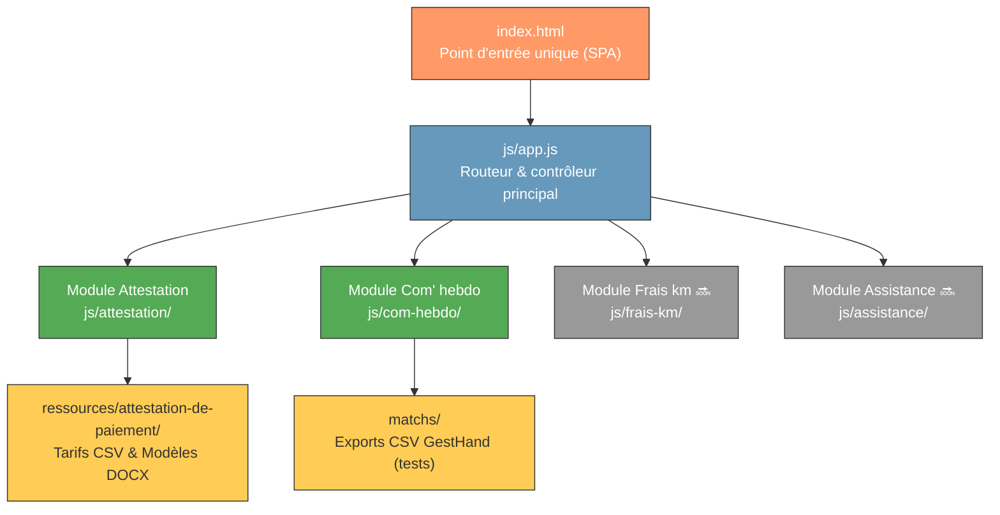
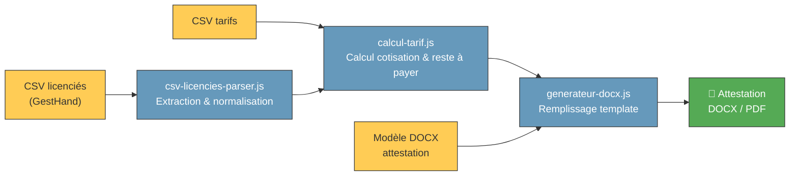
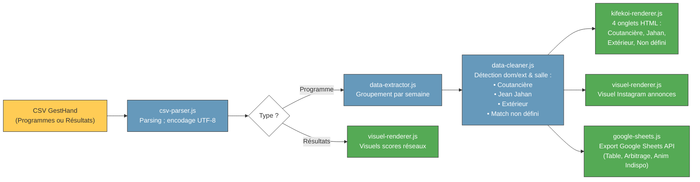

# 🏗️ Architecture du projet Super Chapelaine

## Vue d'ensemble

Super Chapelaine est une **application web statique mono-page (SPA)** qui
regroupe plusieurs outils de gestion pour le club de handball La Chapelaine.

L'architecture repose sur des principes simples :
- **Zéro backend** : tout s'exécute côté client dans le navigateur
- **JavaScript vanilla** : ES Modules natifs (`import`/`export`), aucun bundler ni transpileur
- **CSS natif** : variables CSS (`:root`) pour la cohérence visuelle et le thème du club
- **Modularité** : chaque outil est un module autonome et indépendant dans son sous-dossier `js/<module>/`

---

## Architecture des modules



---

## Flux de données — Attestation de paiement



---

## Flux de données — Communication hebdomadaire (Com' Hebdo)

Le module Com' Hebdo traite les exports GestHand pour générer les plannings (kifekoi), les visuels réseaux sociaux et l'export Google Sheets.



---

## Structure des répertoires

```
super-chapelaine/
│
├── index.html                  ← SPA : point d'entrée unique (menu modules & conteneurs)
├── Makefile                    ← Commandes du projet (servir, verifier, openspec...)
├── AGENTS.md                   ← Instructions pour les agents IA
├── README.md                   ← Documentation générale
│
├── js/                         ← Code JavaScript (ES Modules natifs)
│   ├── app.js                  ← Point d'entrée & routage inter-modules
│   ├── attestation/            ← Module Attestation de paiement
│   │   ├── attestation-app.js  ← Contrôleur du module attestation
│   │   ├── calcul-tarif.js     ← Calcul et déduction des cotisations
│   │   ├── csv-licencies-parser.js ← Analyse des CSV GestHand licenciés
│   │   └── generateur-docx.js  ← Rendu et export DOCX
│   └── com-hebdo/              ← Module Communication hebdomadaire
│       ├── com-hebdo-app.js    ← Contrôleur du module com' hebdo
│       ├── csv-parser.js       ← Analyse des CSV GestHand (programmes/résultats)
│       ├── data-extractor.js   ← Extraction et groupement par semaine
│       ├── data-cleaner.js     ← Normalisation équipes, détection dom/ext & salle
│       ├── competitions.js     ← Mapping poules & clubs vers libellés d'affichage
│       ├── kifekoi-renderer.js ← Rendu HTML du planning kifekoi (4 onglets)
│       ├── visuel-renderer.js  ← Visuels réseaux sociaux (Instagram)
│       ├── google-sheets.js    ← Export Google Sheets API (couleurs & légendes)
│       └── google-config.js    ← Identifiants OAuth Google (non versionné)
│
├── css/                        ← Styles natifs
│   └── style.css               ← Styles globaux et par module (variables CSS :root)
│
├── ressources/                 ← Données et modèles
│   ├── attestation-de-paiement/← Fichiers de référence pour les attestations
│   └── modele-attestation-de-paiement/
│
├── matchs/                     ← Fichiers CSV d'export GestHand (jeux d'essai)
├── mail/                       ← Scripts utilitaires d'envoi de mail (hors SPA)
├── docs/                       ← Documentation détaillée du projet
│   ├── architecture.md         ← Architecture globale et flux (ce document)
│   ├── com-hebdo.md            ← Guide fonctionnel et technique Com' Hebdo
│   └── developpement.md        ← Guide de développement et contribution
│
├── openspec/                   ← Configuration et spécifications OpenSpec
├── .sessions/                  ← Journaux des sessions IA
└── .github/
    └── copilot-instructions.md
```

---

## Conventions et décisions techniques

### Feuille de styles et variables CSS

Le projet utilise exclusivement `css/style.css`. Les variables CSS sont définies dans `:root` :

| Variable   | Utilisation                         |
|------------|-------------------------------------|
| `--orange` | Couleur principale du club          |
| `--dark`   | Texte et arrière-plans sombres      |
| …          | Voir `css/style.css` pour la liste complète |

### Architecture modulaire JavaScript

- Tout le code JS est découpé par **domaine fonctionnel** sous `js/<nom-module>/`.
- Les modules n'ont pas d'état persistant global : chaque module gère son cycle de vie à travers sa fonction d'initialisation appelée par `js/app.js`.
- Les imports utilisent des chemins relatifs explicites avec l'extension `.js` (`import ... from './module.js'`).

### Données CSV et spécificités GestHand

- **Séparateur** : `;` (point-virgule)
- **Encodage** : `UTF-8`
- **Détection des types** :
  - Présence de la colonne `sc rec` → fichier de **Résultats**
  - Absence de colonne `sc rec` → fichier de **Programmes**
- **Gestion des matchs non confirmés** :
  - Tout match sans date fixée (`le` vide) est orienté vers l'onglet **Match non défini** (`salle: 'non-defini'`).
  - Il se scinde en deux blocs distincts : `Domicile — gymnase à définir` et `Extérieur — à définir`, sans fallback précipité vers un gymnase par défaut.

### Librairies externes

Toute librairie tierce est chargée via CDN dans `index.html` (ex: docx, google api client). Aucune dépendance locale (`node_modules`) ni build step n'est requis.
